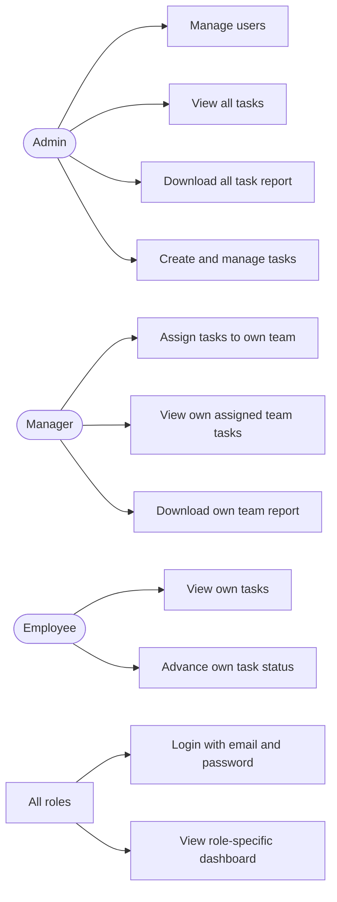
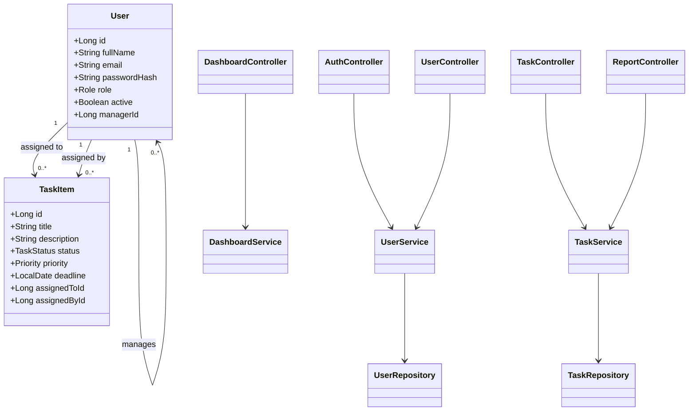
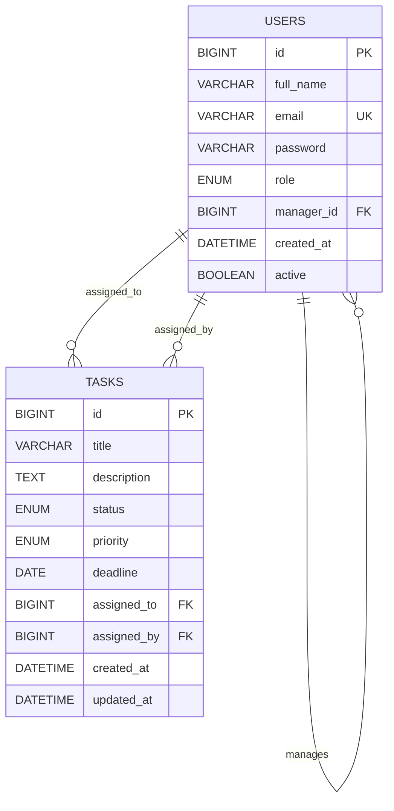

# System diagrams

These Mermaid diagrams are the source format for the required UML Use Case, UML Class, and ER diagrams. GitHub renders them in this file.

## Use Case Diagram

## Class Diagram

## ER Diagram

