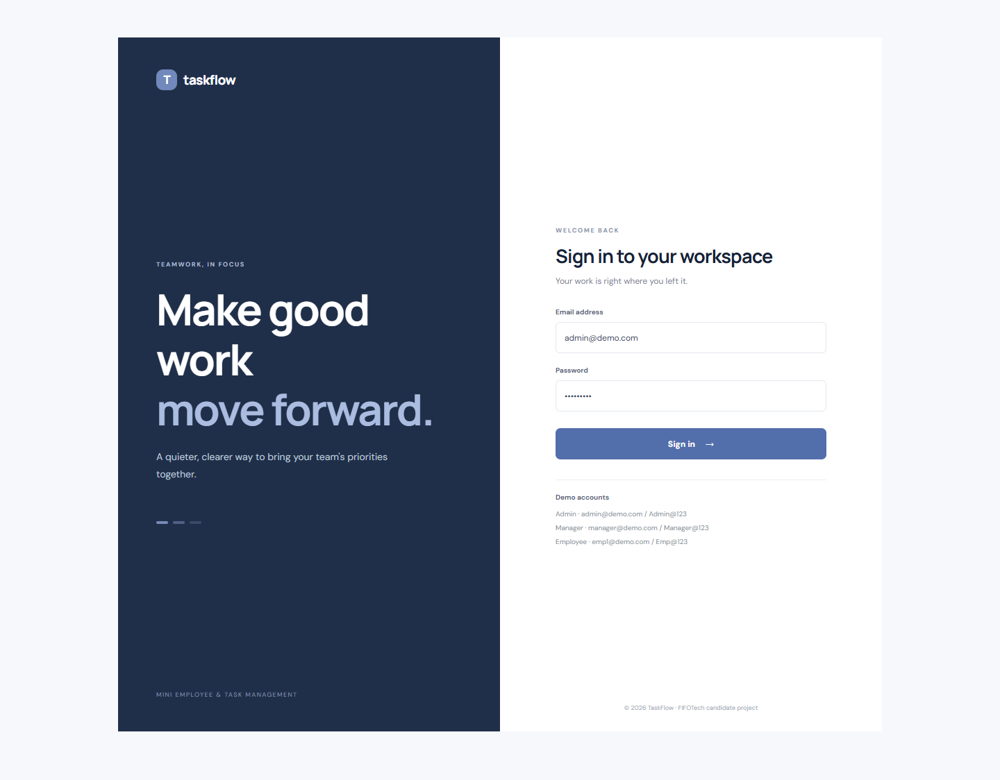
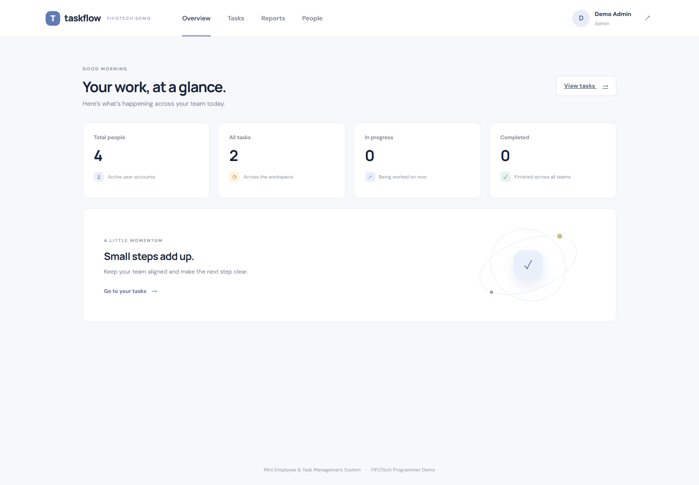
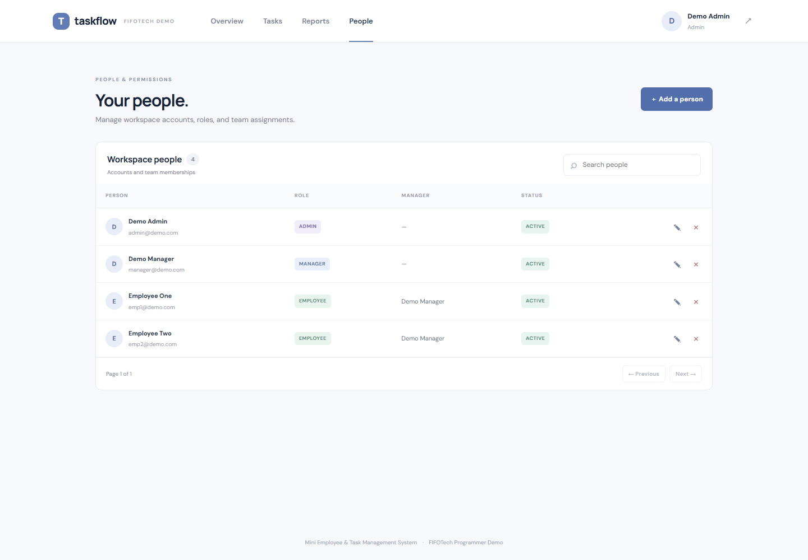
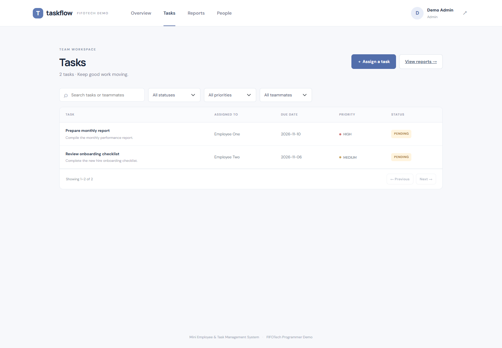
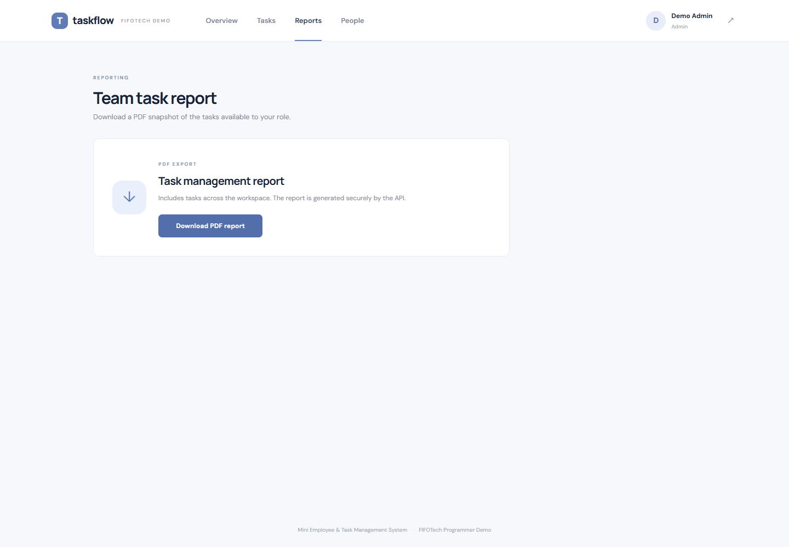
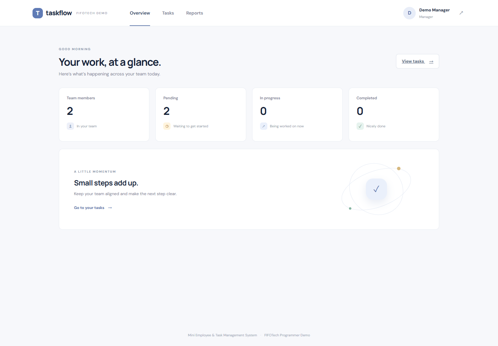
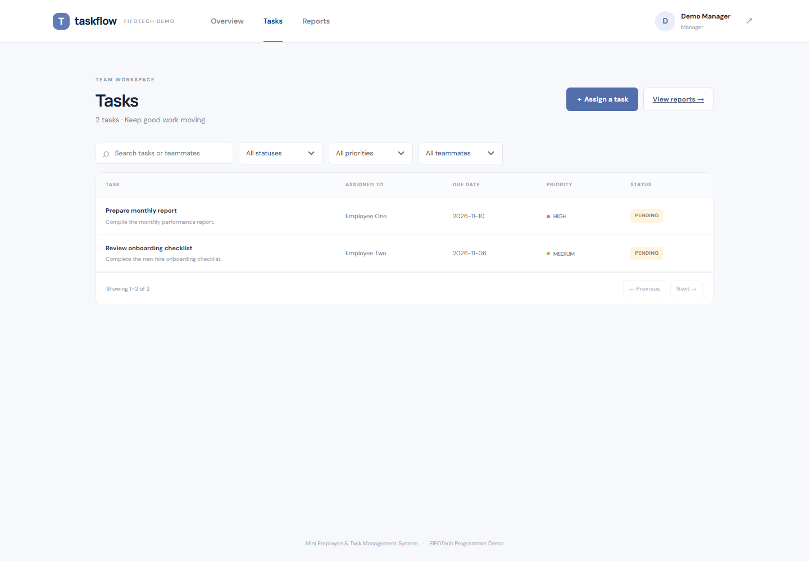
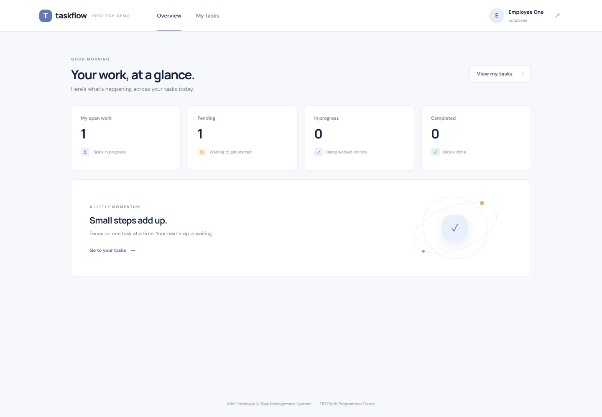
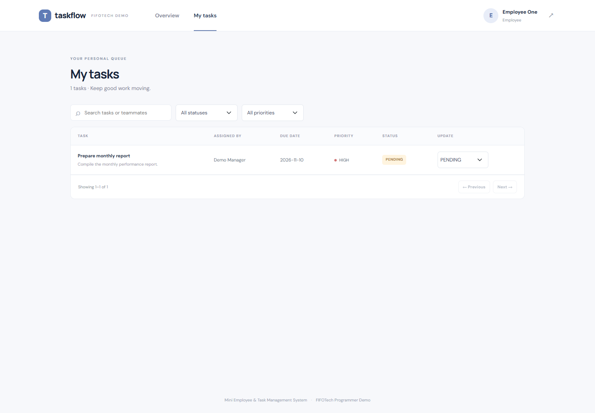

# UI screenshots

These screenshots were captured from the running Angular UI using the seeded demo API. The manager and employee views demonstrate role-specific navigation and data scope.

## Login

## Admin

## Manager

## Employee

